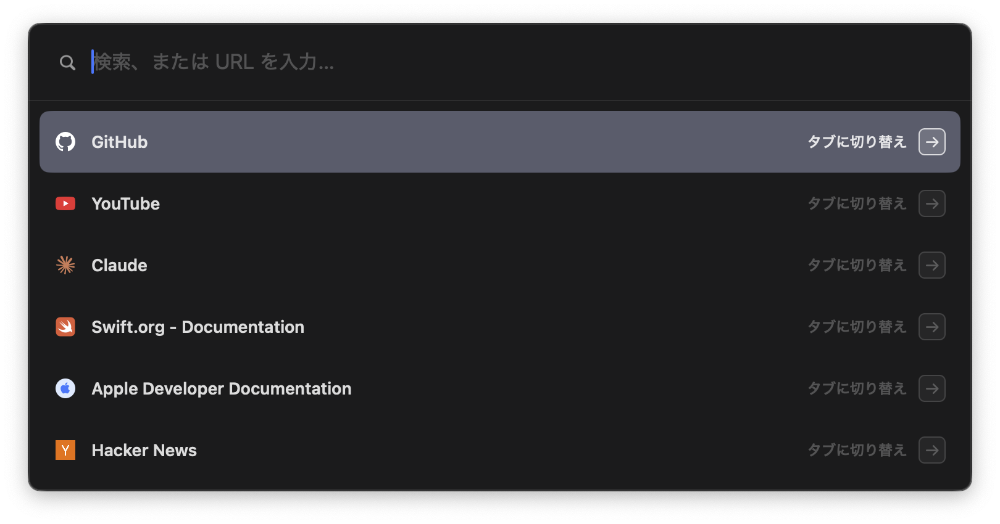
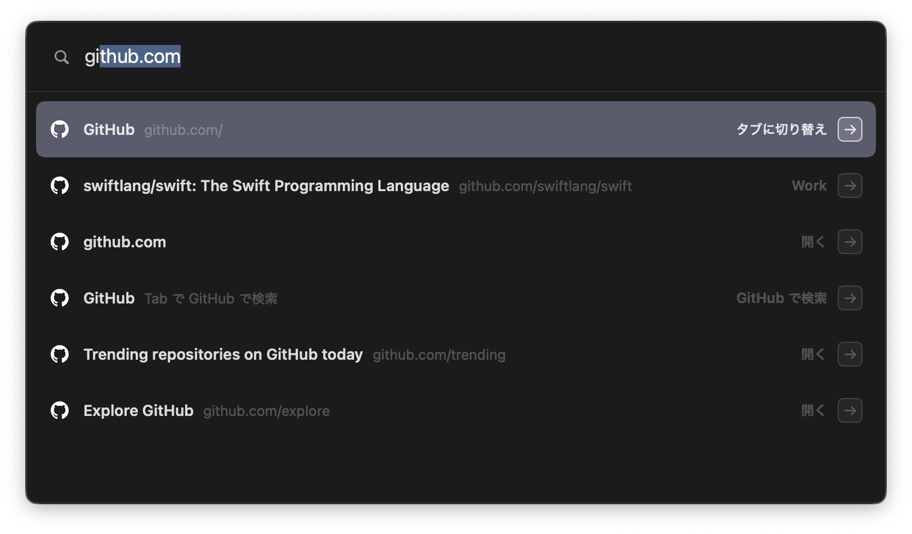
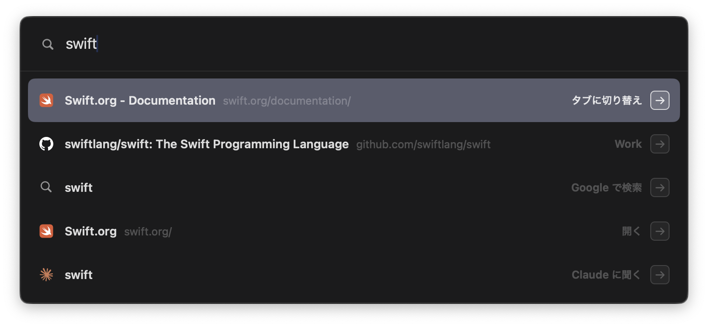
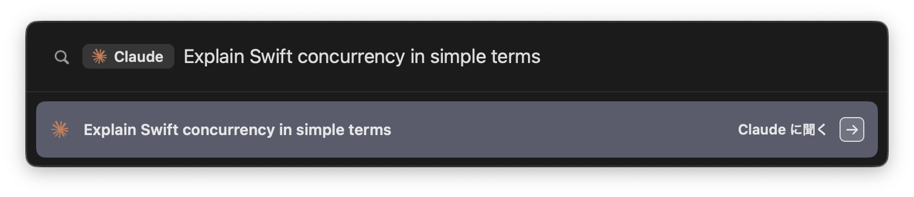

# Dia Command Bar

Dia 用の Arc 風コマンドバー。拡張機能ではなくメニューバー常駐の macOS アプリなので、全スペースで同じように動く。



| ドメインのインライン補完 | 全スペースのタブ・履歴・検索 |
|---|---|
|  |  |

`cl` + Tab で Claude に聞くモード:



スクリーンショットはダミーデータで撮影している（`DCB_DEMO=1` で起動するとデモモードになる。下記参照）。

## 仕組み

- Dia が前面のときだけ ⌘T を Carbon ホットキーとして登録し、他のアプリが前面になったら解除する（アクセシビリティ権限不要）
- パネルはアプリをアクティブにしない `NSPanel`。Dia は前面のまま
- タブを開く／切り替える等は Dia の AppleScript（`Dia.app/Contents/Resources/Dia.sdef`）経由
- 選択を動かさずに Enter を押すと、その瞬間の入力から候補を同期的に作り直して先頭を実行する。サジェストの非同期更新を待たないので、Enter 直前の入力が落ちない
- IME の変換中（未確定）の文字でも候補を出す（独自のフィールドエディタで `setMarkedText` を拾う）

### Dia のスペースと Chromium プロファイル

AppleScript の `profile` は Dia の「スペース」で、`User Data/Profile N`（Chromium プロファイル）とは 1 対 1 ではない（複数スペースが 1 プロファイルを共有する）。
対応はどこにも保存されていないので、名前が一致すればそれ、しなければ「そのスペースで開いているタブの URL を最も多く履歴に持つプロファイル」をそのスペースの履歴として使う。

## ビルド・起動

```sh
./scripts/build-app.sh
open build/DiaCommandBar.app
```

初回にタブを開くとき「DiaCommandBar が Dia を制御しようとしています」という許可ダイアログが出るので許可する。
ad-hoc 署名なので、再ビルドすると許可を求められ直すことがある。

この環境の Command Line Tools は SwiftPM が壊れているので、`build-app.sh` は `swiftc` を直接呼んでいる。
`SwiftBridging` の二重定義エラーが出る場合は、古い CLT の残骸 `/Library/Developer/CommandLineTools/usr/include/swift/module.modulemap` を削除する。

メニューバーの ⌘ アイコンから「ログイン時に起動」を切り替えられる。

### デモモード（スクリーンショット用）

```sh
open --env DCB_DEMO=1 build/DiaCommandBar.app
```

Dia の実際のタブ・履歴の代わりに `DemoData.swift` のダミーデータを使い、Google サジェストも取りに行かない。
パネルのウィンドウだけを撮るには `screencapture -l <ウィンドウ ID>` を使う。

## 見た目・位置

Arc 1.170 のコマンドバーを実測して合わせている。

- 幅 764pt、入力欄 62pt、行 50pt、角丸 10pt、不透明な背景
- Dia の最前面ウィンドウの中央（5 行表示のときパネル全体がウィンドウの縦中央に来る位置に上端を固定）
- 全行の右端にアクション名と矢印。選択行は強調、別スペースのタブはスペース名を表示

## 操作

| キー | 動作 |
|---|---|
| ⌘T（Dia 前面時） | 開く／閉じる |
| ↑ / ↓、Ctrl+P / Ctrl+N、マウスホバー | 候補を選択 |
| Enter | 実行 |
| Tab | `claude` `gpt` `youtube` などを打った状態で、その検索先に切り替え。インライン補完中なら補完を確定 |
| Backspace（検索先モードで空欄） | 検索先モードを抜ける |
| Esc | 検索先モードを抜ける → 閉じる |

## 候補

入力が空のとき: 現在のスペースのタブを最近見た順に最大 6 件（アクティブなタブは除く）

入力があるとき（上から、合計最大 10 行）:
1. 開いているタブ（全スペース、最大 3 件。現在のスペースを優先）
2. コマンド（3 文字以上で一致したとき最大 2 件）: スペース移動 / URL をコピー / タブを閉じる / タブを複製
3. 入力そのもの（URL っぽければ開く、それ以外は Google 検索）
4. 検索先のヒント（`cl` → 「Tab で Claude に聞く」）
5. Claude に聞く / ChatGPT に聞く（URL 入力のときは出さない）
6. 履歴（最大 3 件）
7. Google サジェスト（最大 2 件）

- ドメインはインライン補完する（`gi` → `github.com`）。補完候補は履歴の訪問回数順
- 英数字は単語の先頭一致（`hub` で github はヒットしない）、日本語は部分一致
- 重複排除は Arc の `command_bar_behavior.json` に倣い、Notion / GitHub / Figma などはタイトル + ホストで行う
- Claude は `https://claude.ai/new?q=…`、ChatGPT は `https://chatgpt.com/?q=…` で新しいチャットを開く

## データの読み方

- 履歴・favicon は全プロファイルの `History`・`Favicons` を `immutable=1`（ロックなし・読み取り専用）で読む
- favicon は「ページ URL の完全一致 → 同じホストで最も多く使われているアイコン → サイトの `/favicon.ico`」の順に探す
- ローカルの候補はメモリ上で同期計算（7,500 件で 1 打鍵 2〜5ms）。非同期なのは Google サジェストだけ

## TODO

- ブックマーク（`Bookmarks` JSON）
- 検索エンジン・AI の追加や並び順の設定
